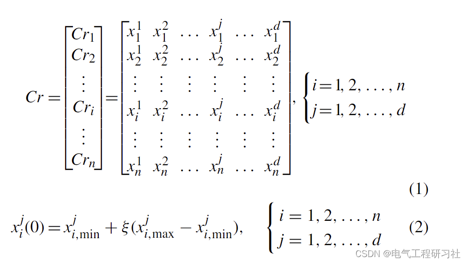
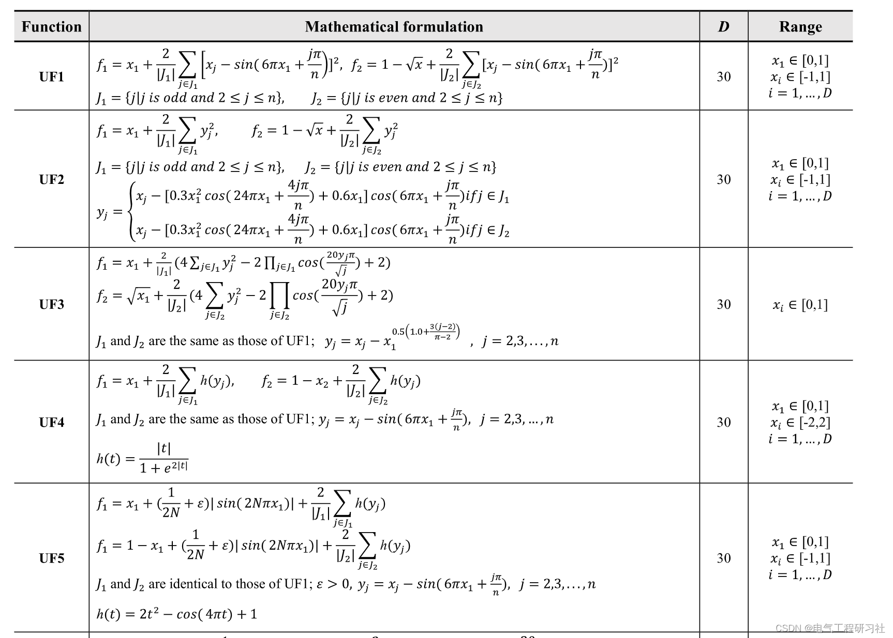
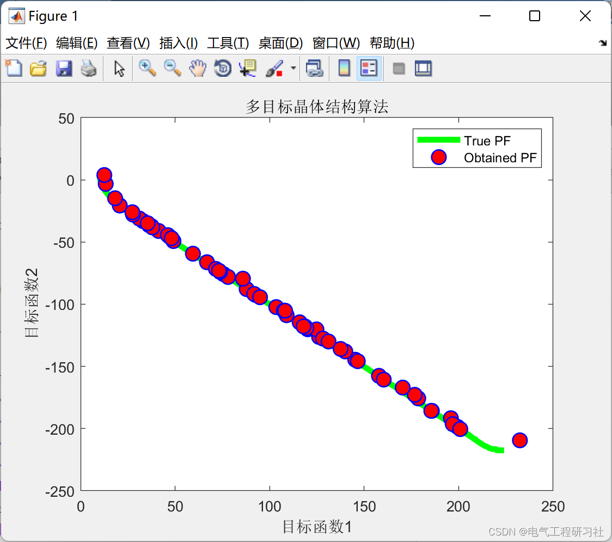
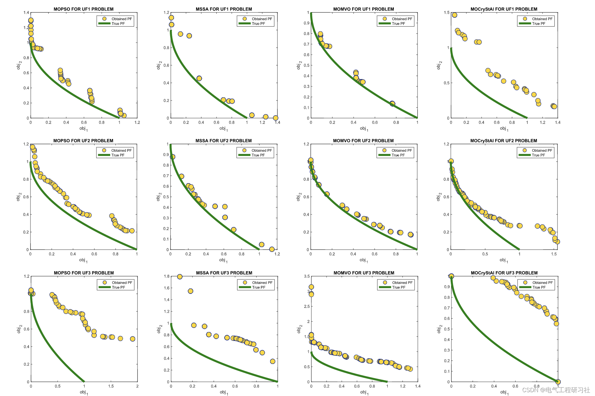
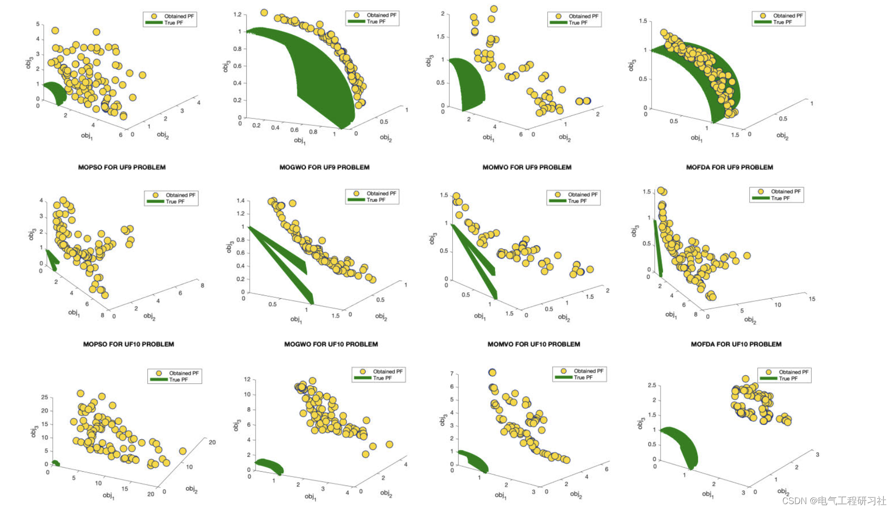
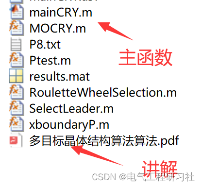

# [Optimization Algorithm] Multi-Objective Crystal Structure Algorithm (Matlab Code Implementation)

​  
1 Overview and Summary
In many optimization problems, the primary goal is to improve a single performance metric, where the minimum or maximum value of this metric sufficiently reflects the quality of the response obtained from the system. However, in some cases, it may not be possible to rely solely on a single metric, thus considering a multi-objective optimization problem with multiple performance metrics, where all values should be optimized simultaneously. The above process requires a multi-objective optimization algorithm that can handle the complexity of simultaneously indexing problems. This paper introduces the recently proposed metaheuristic algorithm called CryStAl, a multi-objective version inspired by the principle of crystal structure formation.For the performance evaluation of this algorithm called MOCryStAl, a benchmark problem known as CEC-09 was used. Some real-world engineering design problems were used to evaluate the efficiency of the proposed method. The results indicate that the proposed method can provide excellent results in handling the considered multi-objective problems.
Keywords: Multi-objective optimization, Metaheuristics, Crystallographic algorithm (CryStAl), Evolutionary Computation (CEC) completion, Real-world engineering design problems
2 Mathematical Model Editing
Edit the detailed mathematical model in Part 4.
3 Running Results Editing
Edit
Edit
4 Matlab Code and Article Explanation
This article only showcases a portion of the code; for the complete code and article, please refer to:
Edit
%-------------------------- MOCrystal -----------------------------------------\n    for i=1:1\n        \n        [Archive_F]=MOCRY(max_iter,ArchiveMaxSize,Pop,nvar,method,j);\n        \n        if numel(Archive_F')==2\n            continue\n        end\n        Archive_F=Archive_F';\n        \n        \n        %%%%%%%%%%%%%%%%%%%%%%%%%%%%%%%%%%%%%%%%%%%%%%%%%%%%%%%%%%%%%%%%%%%%%%%%%%%%%%%%%%%%%%%\n        if obj_no==2\n            plot(Archive_F1(:,1),Archive_F1(:,2),'Color','g','LineWidth',4);\n            hold on\n            plot(Archive_F(:,1),Archive_F(:,2),'ro','LineWidth',1,...\n                'MarkerEdgeColor','b',...\n                'MarkerFaceColor','r',...\n                'Marker','o',...\n                'MarkerSize',10);\n            legend('True PF','Obtained PF');\n            title(sprintf('Multi-objective Crystal Structure Algorithm',j));\n            xlabel('Objective function1');\n            ylabel('Objective function2');\n            \n            hold off\n        end\n        if obj_no==3\n            plot3(Archive_F1(:,1),Archive_F1(:,2),Archive_F1(:,3),'Color','g','LineWidth',1);\n            hold on\n            plot3(Archive_F(:,1),Archive_F(:,2),Archive_F(:,3),'ro','LineWidth',1,...\n                'MarkerEdgeColor','b',...\n                'MarkerFaceColor','r',...\n                'Marker','o',...\n                'MarkerSize',10);\n            legend('True PF','Obtained PF');\n            title(sprintf('Multi-objective Crystal Structure Algorithm (MOCryStAl)',j));\n            xlabel('Objective function1');\n            ylabel('Objective function2');\n            zlabel('Objective function3');\n            \n            hold off\n        end\n        \n        \n        \n        \n        savefig(sprintf('P%d/fig_%d.fig',j,i));\n        \n    end\n    \n    \n    save(sprintf('P%d/result_P%d.mat',j,j));\n    \nend\n  
5 Conclusion This paper introduces the multi-objective version of the CrystAl algorithm, a metaheuristic inspired by some geometric principles of crystal structures, including lattice and base in the crystal structure. For performance evaluation of the algorithm, the benchmark problem for multi-objective optimization is completed using evolutionary computation with CEC-09. Some real-world engineering design problems are used to evaluate the efficiency of the proposed MOCryStAl method. The paper demonstrates that MOCryStAl can outperform other methods in five CEC-09 problems when considering IGD index, while other methods such as MSSA also produce very competitive results.Regarding GD, the average results of UF8 in MOCryStAl are respectively 90%, 80% and 28% different from those of MOPSO, MSSA and MOMVO, which demonstrates the capability of 117808 VOLUME 9, 2021 N. Khodadadi et al.: MOCryStAl: introduction and performance evaluation of a multi-objective algorithm proposed to handle such challenging problems.By considering the real and obtained Pareto fronts of CEC-09, ZDT and DTLZ problems, it is concluded that the proposed MOCryStAl method can create better solutions closer to the Pareto front.
6 References N. Khodadadi, M. Azizi, S. Talatahari and P. Sareh, "Multi-Objective Crystal Structure Algorithm (MOCryStAl): Introduction and Performance Evaluation," in IEEE Access, vol. 9, pp. 117795-117812, 2021, doi: 10.1109/ACCESS.2021.3106487.  
7 End Note

## Images

<!-- PAYMENT_BLOCK -->

## Get this dataset

- Payment link (Stripe): [Buy now](https://buy.stripe.com/3cs8yP7sY87d0vu9AB)
- Payment QR code: 

<!-- /PAYMENT_BLOCK -->
